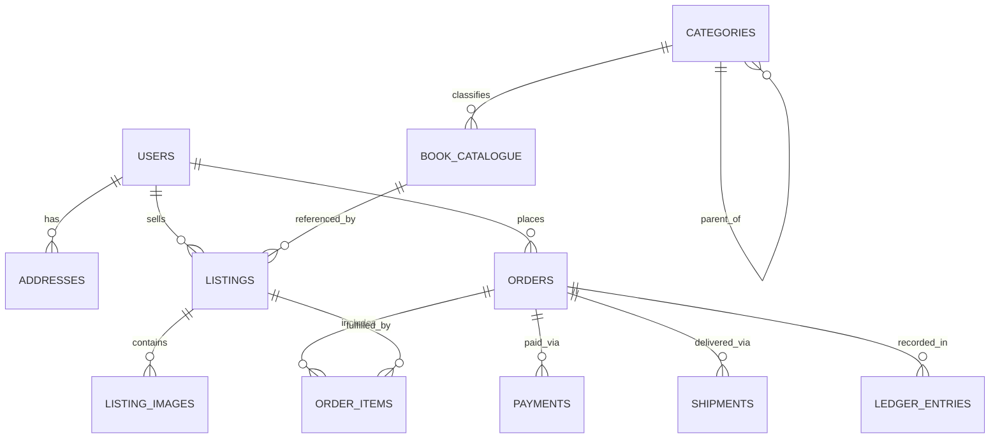

# BookLoop Data Model & Entity Relationships

## Core Entities
1. **Category**: Hierarchical taxonomy with `parent_id`, `slug`, `name`, `icon`, `is_active`.
2. **BookCatalogue**: Authoritative bibliographic record (`title`, `subtitle`, `authors`, `isbn_10`, `isbn_13`, `publisher`, `edition`, `publication_year`, `language`, `mrp`, `page_count`, `category_id`).
3. **Listing**: Physical copy listed by a seller (`seller_id`, `book_catalogue_id`, `custom_title`, `price`, `condition_grade`, `missing_pages_defect`, `notes`, `status`, `pickup_address_id`).
4. **ListingImage**: Authenticated photographs of the actual physical copy.
5. **Order**: Transaction entity representing purchase from buyer with calculated price breakdown.
6. **Shipment**: Physical parcel delivery entity with courier provider, tracking code, dimensions, weight, pickup address, and shipping events.
7. **Payment & LedgerEntry**: Double-entry ledger recording all credit/debit movements with immutable audit records.
