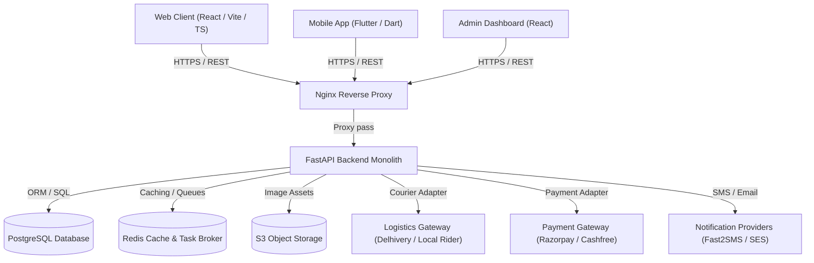

# BookLoop System Architecture

## Architectural Tenets
1. **Modular Monolith**: Clean domain boundaries (Auth, Catalog, Listings, Orders, Delivery, Payments, Admin) inside a single FastAPI application to avoid microservice complexity while retaining clean separation.
2. **Provider-Independent Adapters**: Logistics, payments, notifications, and object storage all adhere to strict abstract base interfaces. Third-party vendor changes require zero refactoring of core domain logic.
3. **Decoupled Data Architecture**: Bibliographic metadata is separated from individual seller physical inventory copies, enabling multiple sellers to list their unique condition copies against a unified book record.
4. **Idempotent Financial Ledger**: All monetary movements generate double-entry ledger entries, maintaining immutable financial auditability.
